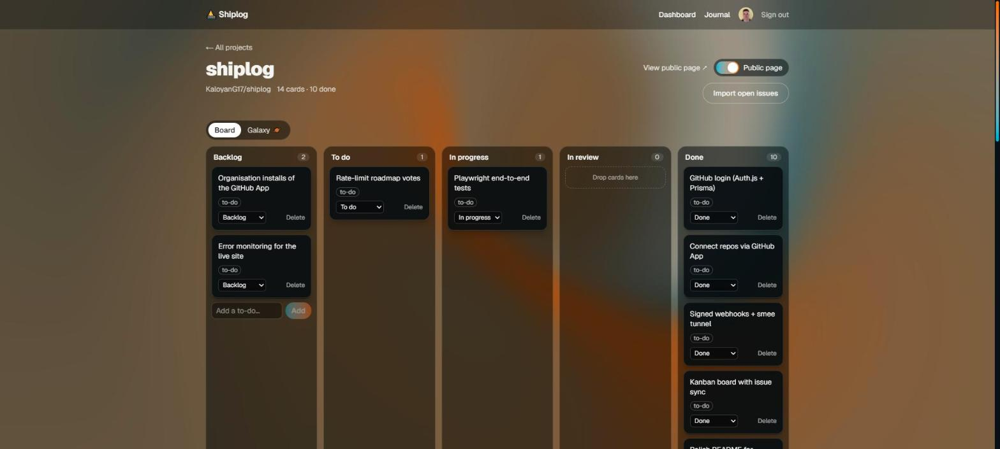
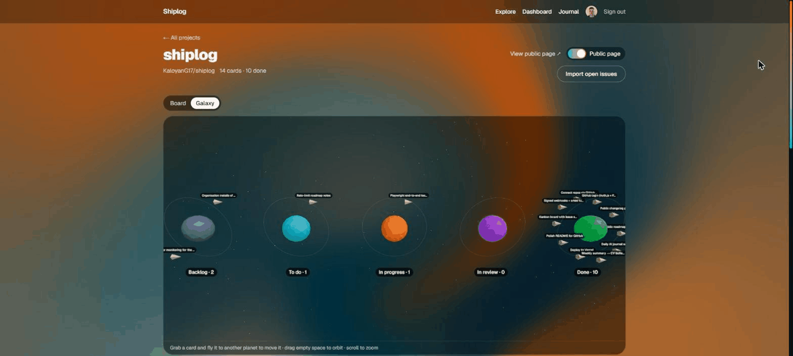
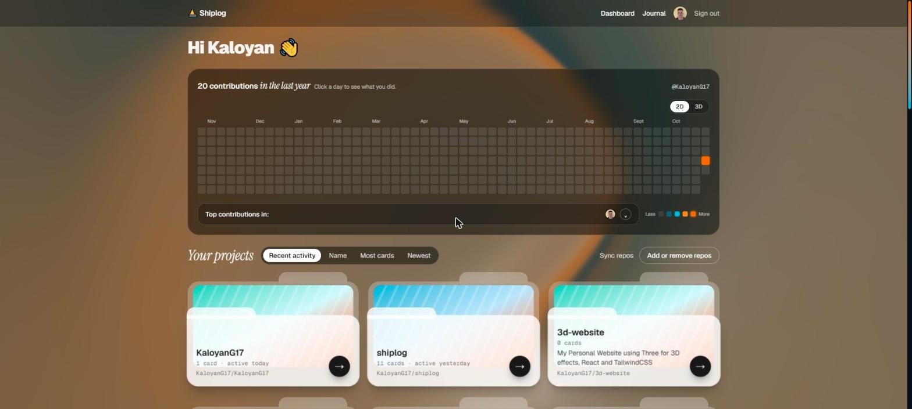
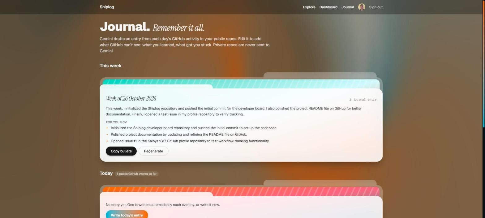
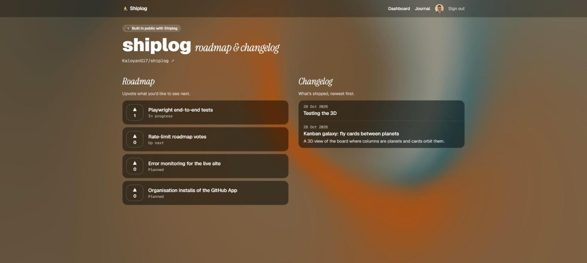
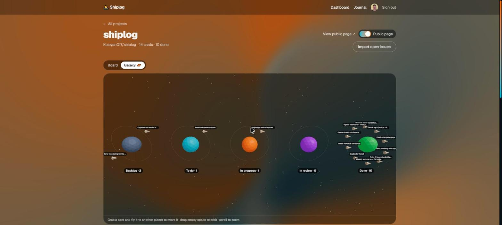
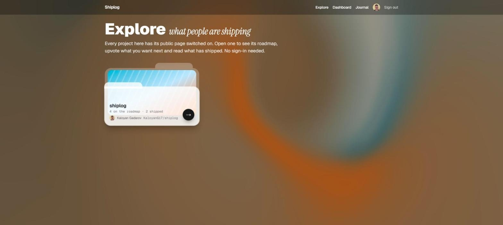
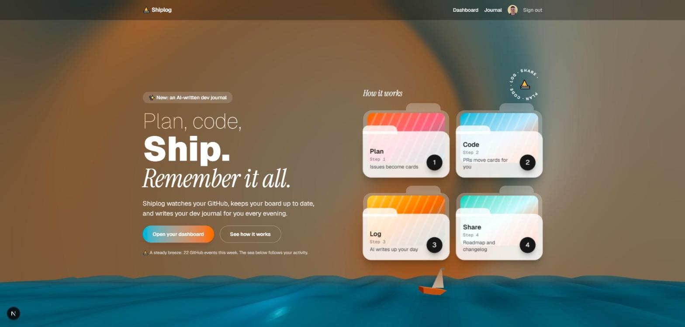
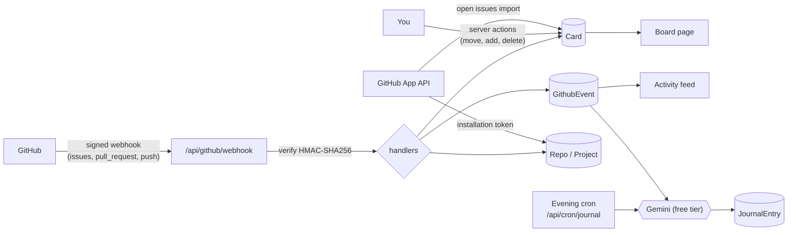

# Shiplog

**A personal dev board that keeps itself up to date from GitHub.**
Issues become cards, pull requests move them across the board, every push, issue and PR lands in a project activity feed, and each evening an AI writes up your day in a dev journal.

[](https://github.com/KaloyanG17/shiplog/actions/workflows/ci.yml)


**Live: [shiplog-silk.vercel.app](https://shiplog-silk.vercel.app)** · **Public roadmap & changelog: [shiplog-silk.vercel.app/p/shiplog](https://shiplog-silk.vercel.app/p/shiplog)** (no sign-in needed)



*Shiplog's own board, tracking Shiplog's roadmap: the project is built with itself.*

---

## Why

As a solo developer my tasks lived in one place, my code in GitHub, and my notes nowhere. When it was time for a standup, a review or a CV update, I couldn't remember what I'd shipped. Shiplog uses GitHub activity as the source of truth, so the board and the history keep themselves current.

**The loop:** Plan → Code → Log → Share

| Step | What Shiplog does | Status |
|---|---|---|
| **Plan** | Kanban board per project; GitHub issues sync in as cards next to private to-dos | Working |
| **Code** | Webhooks move cards as you open, review and merge PRs | Working |
| **Log** | Activity feed per project; AI-drafted daily journal; weekly summary with CV bullets | Working |
| **Share** | Public project page with an upvotable roadmap and a changelog of merged PRs | Working |

## Features

- **Sign in with GitHub** (Auth.js), with sessions stored in PostgreSQL.
- **Connect repos with a GitHub App.** You pick exactly which repos Shiplog can read, and each repo becomes a project. Repos added or removed on GitHub are synced automatically.
- **Kanban board per project:** Backlog → To do → In progress → In review → Done.
  - Drag and drop, plus a "Move to" dropdown for keyboard and touch users.
  - Optimistic updates: moves appear instantly and are saved in the background.
  - Private to-dos sit next to issue cards; import a repo's open issues in one click.
- **Cards follow GitHub automatically:**

  | On GitHub | On the board |
  |---|---|
  | Issue opened | New card in **Backlog** |
  | Draft PR with `Fixes #12` | Card #12 → **In progress** |
  | PR ready for review | **In review** |
  | PR merged / issue closed | **Done** |
  | PR closed without merging | Back to **In progress** |
  | Issue reopened | **To do** |
  | Issue edited / deleted | Card updated / removed |

- **Activity feed** in plain English: "merged PR #4: Add login", "pushed 3 commits to main: …".
- **Live updates:** project pages refresh in the background, so webhook changes appear without a reload.
- **Daily AI journal:** every evening Gemini turns the day's commits, issues and PRs across your public repos into a short first-person entry. Private repos are never sent to the model. You can edit it to add what GitHub can't see (what you learned, what got you stuck), regenerate it, or write today's entry on demand. Days follow your local time zone, not UTC.
- **Weekly summary → CV bullets:** one click turns the week's journal into a short summary and three CV-ready bullet points, with a Copy button.
- **Public project page** (`/p/<project>`): switch it on per project to share an upvotable roadmap of open cards (anonymous, one vote per visitor) and a changelog that merged PRs add to automatically.
- **Explore** (`/explore`): every public project in one list of cards, open to anyone without signing in.
- **Contribution heatmap:** your real GitHub contribution year on the dashboard. Click a day to see the projects you worked on and that day's journal entry. A labelled sample-data mode fills it in for demos.
- **In 3D** (React Three Fiber, loaded only when used, and still for reduced motion):
  - **Contribution skyline:** a 2D / 3D switch turns the heatmap into a city of bars you can orbit; click a bar to open that day.
  - **Kanban galaxy:** each column is a planet and its cards orbit it as small ships; grab one and fly it to another planet to move the card.
  - **Sailboat:** the homepage sea gets rougher the busier your past week was.
  - **3D folder cards** that tilt toward the mouse.



### Screenshots

| Dashboard | Journal |
|---|---|
|  |  |
| **Public roadmap & changelog** | **Kanban galaxy** |
|  |  |
| **Explore public projects** | **Homepage** |
|  |  |

*The dashboard screenshot uses the heatmap's labelled sample-data mode.*

## How it works



1. **Login** uses a GitHub OAuth app through Auth.js; sessions live in Postgres via the Prisma adapter.
2. **Repo access** uses a separate GitHub App with read-only permissions. After installing it, GitHub redirects to `/api/github/setup`, which links the installation to the signed-in user and syncs its repos.
3. **Webhooks** hit `/api/github/webhook`. The request signature is checked against the raw body, the event is stored, and handlers update repos and cards.
4. **The board** is a React client component that calls server actions; every action checks that the signed-in user owns the card or project.
5. **The journal** collects a day's events and asks Gemini for a draft. A cron job (Vercel Cron, protected by `CRON_SECRET`) writes missing entries each evening; the Journal page lets you write, edit and regenerate them.

## Engineering notes

Decisions worth calling out:

- **Webhook security:** every delivery is verified with `X-Hub-Signature-256` (HMAC-SHA256 of the *raw* body) before anything is parsed. Bad signatures get `401`, and handler failures return `500` so GitHub marks the delivery as failed and it can be redelivered.
- **Idempotent event storage:** GitHub can deliver an event more than once. The `X-GitHub-Delivery` ID is a unique column, so duplicates are skipped instead of double-counted.
- **Installation ownership check:** the `installation_id` in the setup redirect comes from the query string, so anyone could send one. Shiplog fetches the installation with an app JWT and only accepts it if its GitHub account matches the signed-in user's.
- **Authorisation in server actions:** server actions are public HTTP endpoints, so each one re-checks ownership of the card or project it touches, and validates input with Zod.
- **Race-safe syncing:** the setup redirect and the `installation_repositories` webhook can add the same repo at the same moment. A project is linked with a conditional update (`projectId IS NULL`), and the losing side deletes its duplicate.
- **64-bit GitHub IDs:** GitHub issue IDs have already passed the 32-bit integer limit, so all GitHub IDs are stored as `BigInt`.
- **Next.js 16 Cache Components:** pages prerender a static shell, and anything that reads the session is streamed inside `<Suspense>`. A small `getSession()` helper calls `connection()` before Auth.js, which otherwise touches `crypto` and `Date.now()` during prerendering.
- **Free-tier AI that degrades gracefully:** the journal runs on Gemini's free tier, whose shared capacity is sometimes busy (`503`) or out of quota (`429`). Instead of the SDK's long built-in retries, each model gets one 30-second attempt and the next free model takes over, so a busy model costs seconds rather than a failed entry.
- **Private code stays private:** Gemini's free tier may use prompts to improve Google's products, so the journal query filters to public repos at the database level; private-repo events never leave the app.
- **Prompt-injection-aware prompt:** commit messages and issue titles are user-controlled text. They're wrapped in an `<activity>` block and the system instruction tells the model to treat them strictly as content to summarise.
- **Time-zone-correct days:** "today" means the developer's calendar day (Europe/Sofia by default), computed with `Intl` and checked across daylight-saving changes, including the 25-hour day in October.
- **Accessibility:** drag and drop has a keyboard- and touch-friendly dropdown alternative, columns are labelled regions, and controls have screen-reader labels.

## Tech stack

| Area | Choice |
|---|---|
| Framework | Next.js 16 (App Router, Server Components, Server Actions, Cache Components) |
| Language / UI | TypeScript, React 19, Tailwind CSS 4 |
| Database | PostgreSQL on [Neon](https://neon.tech), Prisma 7 with the `pg` driver adapter |
| Auth | Auth.js v5 (GitHub provider, Prisma adapter) |
| GitHub | GitHub App + Octokit (`@octokit/app`, `@octokit/webhooks`) |
| AI | Google Gemini API, free tier (`@google/genai`) |
| Hosting | Vercel (serverless functions, Vercel Cron) |
| Scheduled jobs | Vercel Cron |
| 3D | Three.js with React Three Fiber and drei |
| Testing / CI | Vitest, GitHub Actions (lint, typecheck, tests, build) |
| Validation | Zod |
| Local webhooks | [smee.io](https://smee.io) tunnel |

## Roadmap

- [x] GitHub login (Auth.js + Prisma)
- [x] Connect repos through a GitHub App; one project per repo
- [x] Signed webhook endpoint with event storage
- [x] Kanban board with issue sync and PR-driven card moves
- [x] Daily AI journal: drafted from the day's GitHub activity, editable
- [x] Weekly summaries and CV bullets
- [x] Public project page: changelog from merged PRs and manual entries
- [x] Public roadmap with upvotes
- [x] Unit tests (Vitest) and CI on GitHub Actions
- [x] 3D: contribution skyline, kanban galaxy, homepage sailboat
- [x] Deploy to Vercel
- [ ] End-to-end tests (Playwright) for sign-in and the board
- [ ] Rate-limit roadmap votes
- [ ] Error monitoring for the live site
- [ ] Organisation installs of the GitHub App

---

## Running it locally

Requires Node.js 20+ and a PostgreSQL database (a local install, or a free one from [Neon](https://neon.tech) or [Supabase](https://supabase.com)).

1. **Install dependencies** (this also generates the Prisma client):
   ```bash
   npm install
   ```
2. **Create `.env`** by copying `.env.example`, then fill it in:
   - `DATABASE_URL`: your Postgres connection string (for Neon, use the direct, non-pooled one)
   - `AUTH_SECRET`: generate one with `npx auth secret`
   - `AUTH_GITHUB_ID` / `AUTH_GITHUB_SECRET`: create a GitHub OAuth app at
     <https://github.com/settings/developers> with callback URL
     `http://localhost:3000/api/auth/callback/github`
   - `GEMINI_API_KEY`: a free key from <https://aistudio.google.com/apikey> (on the free tier Google may use prompts to improve its products, which is why only public-repo activity is sent)
   - `CRON_SECRET`: any long random string; it protects the evening journal job
3. **Create the database tables:**
   ```bash
   npm run db:migrate
   ```
4. **Set up the GitHub App and webhooks** (below).
5. **Start the app** and the webhook tunnel in two terminals, then open <http://localhost:3000>:
   ```bash
   npm run dev
   ```
   ```bash
   npm run webhooks:dev
   ```

### GitHub App

Login uses the OAuth app above. Reading repos uses a separate **GitHub App**, so you choose exactly which repos Shiplog can see.

1. Go to <https://github.com/settings/apps> → **New GitHub App**:
   | Field | Value |
   |---|---|
   | GitHub App name | must be unique on GitHub, e.g. `Shiplog <your-name> dev` |
   | Homepage URL | `http://localhost:3000` |
   | Callback URL / "Request user authorization during installation" | leave empty / unticked |
   | Setup URL | `http://localhost:3000/api/github/setup`, and tick **Redirect on update** |
   | Webhook → Active | ticked |
   | Webhook URL | your `SMEE_URL` (run `npm run webhooks:dev` once to get a channel) |
   | Webhook secret | the same value as `GITHUB_WEBHOOK_SECRET` in `.env` |
   | Repository permissions | Contents, Issues, Pull requests: **Read-only** (Metadata is added automatically) |
   | Subscribe to events | Issues, Pull request, Push |
   | Where can this GitHub App be installed? | Only on this account |
2. After creating it, note the **App ID** and the **slug** (the end of the app's public URL, `github.com/apps/<slug>`).
3. Under **Private keys**, click **Generate a private key**. A `.pem` file downloads.
4. Fill in `GITHUB_APP_ID`, `GITHUB_APP_SLUG` and `GITHUB_APP_PRIVATE_KEY` in `.env`. The key must be on one line with each line break written as `\n`.
5. Open the dashboard and click **Connect GitHub repos**.

> smee.io channels are public: anyone with the URL can watch the events passing through. That's fine for development; in production GitHub calls the deployed URL directly.

### Scripts

| Command | What it does |
|---|---|
| `npm run dev` | Start the dev server |
| `npm run webhooks:dev` | Forward GitHub webhooks from smee.io to the dev server |
| `npm run build` / `npm start` | Production build / run it |
| `npm run lint` / `npm run typecheck` | ESLint / TypeScript checks |
| `npm test` / `npm run test:watch` | Unit tests (Vitest) |
| `npm run db:migrate` | Create and apply a migration after changing `prisma/schema.prisma` |
| `npm run db:studio` | Browse the database in Prisma Studio |

After a migration, restart `npm run dev` so it picks up the regenerated Prisma client.

To run the evening journal job by hand (it's scheduled in `vercel.json` when deployed):

```bash
curl -H "Authorization: Bearer <your CRON_SECRET>" http://localhost:3000/api/cron/journal
```

### Project structure

```
prisma/
  schema.prisma              Database models (Auth.js + Shiplog)
  migrations/                SQL migrations
scripts/webhook-tunnel.mjs   smee.io → localhost webhook forwarder
src/
  auth.ts                    Auth.js setup + getSession() helper
  app/
    page.tsx                 Landing page
    login/                   Sign-in page
    dashboard/               Project list, "Sync repos" action
    projects/[id]/           Board (client), server actions, activity feed
    journal/                 Journal page, entry editor, server actions
    api/auth/                Auth.js routes
    api/cron/journal/        Evening job that writes missing journal entries
    api/github/setup/        GitHub App install redirect
    api/github/webhook/      Signed webhook endpoint
  lib/
    db.ts                    Shared Prisma client
    github.ts                GitHub App client and links
    installations.ts         Installation ownership check and repo sync
    webhooks.ts              Webhook verification and event handlers
    cards.ts                 Issue → card sync and PR-driven moves
    activity.ts              Event → one-line summary
    journal.ts               Day ranges, activity digest, Gemini drafts with model fallback
vercel.json                  Cron schedule for the journal job
```

---

Built by [Kaloyan Gadarov](https://github.com/KaloyanG17).
